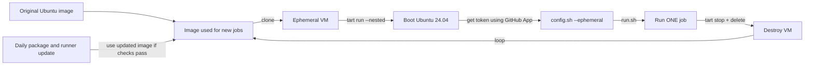

# macOS GitHub Actions Runner Setup

These scripts install GitHub Actions runners on Apple Silicon Macs. You can run
both types on the same Mac:

1. **macOS / AVF runners:** jobs run directly on the Mac and can use Apple's
  Virtualization.framework (AVF). Only the runner's `_work` directory is cleared
  after each job. Changes elsewhere on the Mac remain and can affect later jobs.
2. **Ubuntu / KVM runners:** each job runs in a fresh Ubuntu VM with KVM support.
  The VM is deleted after the job. A writable build cache on the Mac is shared
  with later jobs on the same runner. See [Ubuntu / KVM Runners](#ubuntu--kvm-runners).

The macOS jobs cannot use the same VM isolation: Apple does not expose AVF
inside a macOS VM. Linux VMs can use nested virtualization on the supported Macs
listed below, which lets jobs run their own KVM guests.

## Requirements

- **Apple Silicon only.** This repo targets arm64 Macs (M-series); Intel/x64 is
  not supported.
- **macOS:** the macOS / AVF runners run on any reasonably current macOS. The
  Ubuntu / KVM runners need **macOS 15 (Sequoia)+ on M3/M4** — see that
  section's [requirements](#tart-requirements).
- The Mac must reach GitHub over outbound HTTPS on port 443.

GitHub documentation:

- [Add a self-hosted runner](https://docs.github.com/en/actions/hosting-your-own-runners/managing-self-hosted-runners/adding-self-hosted-runners)
- [About self-hosted runners](https://docs.github.com/en/actions/reference/runners/self-hosted-runners)
- [Remove a self-hosted runner](https://docs.github.com/en/actions/hosting-your-own-runners/managing-self-hosted-runners/removing-self-hosted-runners)

---

# macOS / AVF Runners

Jobs run directly on the Mac and can use Apple's Virtualization.framework (AVF).
The setup script downloads the GitHub runner, registers it with your repository
or organization, and installs services to keep it running.

Each runner gets its own directory and home folder. You can also give each
runner a [separate macOS account](#separate-users-per-runner). Neither option
isolates jobs from the Mac; cleanup only removes the runner's `_work` directory.

## Scripts

- `bootstrap-gh-runners.sh`: downloads and registers the runners. With `--install-launchd`, it also creates their macOS service files (plists).
- `github-runner-wrapper.sh`: keeps the Mac awake, restarts a crashed runner and handles requests to stop it.
- `github-runner-cleanup.sh`: clears `_work` after each job. Setup copies it into each runner directory and enables it through `ACTIONS_RUNNER_HOOK_JOB_COMPLETED`.

## 1. Get A Registration Token

In your repository or organization:

1. Go to Settings -> Actions -> Runners.
2. Click New self-hosted runner.
3. Select macOS and the correct architecture for your Mac.
4. Note the repository or organization and copy the registration token.

Important:

- Do not commit tokens to git.
- If a token expires, generate a new one and rerun bootstrap.

## 2. Install The macOS Runners

Run this from the folder containing the scripts. Replace `your-org` and
`YOUR_REGISTRATION_TOKEN` with your values. This installs three runners that
start after reboot without anyone signing in (LaunchDaemon services):

```bash
sudo bash bootstrap-gh-runners.sh \
  --dir-prefix "$HOME/github-runner" \
  --count 3 \
  --org your-org \
  --token "YOUR_REGISTRATION_TOKEN" \
  --replace \
  --install-launchd \
  --launchd-scope daemon \
  --launchd-user "$USER"
```

Alternatively, to run only while your account is signed in, use LaunchAgent
services. This example registers runners for a repository:

```bash
bash bootstrap-gh-runners.sh \
  --dir-prefix "$HOME/github-runner" \
  --count 3 \
  --repo owner/repo \
  --token "YOUR_REGISTRATION_TOKEN" \
  --replace \
  --install-launchd \
  --launchd-scope agent
```

What this creates:

- `$HOME/github-runner-1`
- `$HOME/github-runner-2`
- `$HOME/github-runner-3`

Each service sets `HOME` to its runner's `.home` directory (for example,
`$HOME/github-runner-1/.home`). This keeps tools such as rustup from writing to
the same home folder at once. Homebrew, `/tmp`, keychains and system services
are still shared.

Common options:

- `--labels <csv>`: comma-separated custom labels (default `hvf`). Replaces the default custom labels, but not GitHub's automatic `self-hosted`, `macOS` and `ARM64` labels.
- `--runner-group <name>`: organization or enterprise runner group.
- `--name-prefix <prefix>`: prefix for runner names in GitHub.
- `--runner-user-prefix <prefix>`: create a separate non-admin macOS account for each runner. See [Separate users per runner](#separate-users-per-runner).
- `--token-file <path>`: read the registration token from a file instead of `--token`, keeping it out of shell history and the process list.
- `--replace`: stop and re-register existing runners without reinstalling their files. Replaces a runner with the same name in GitHub.
- `--force-recreate`: stop existing runners, delete their directories and reinstall. Also replaces runners with the same names in GitHub.
- `--install-launchd`: install or reload services for the requested runner count.
- `--uninstall-launchd`: stop and remove services for the requested runner count, then exit. No token, repository or organization is needed. Use `sudo` to also remove boot-time services.
- `--launchd-scope <agent|daemon>`: `agent` starts at sign-in; `daemon` starts at boot.
- `--launchd-user <user>`: account that runs boot-time services.
- `--launchd-dir <dir>`: folder for service files.
- `--launchd-label-prefix <prefix>`: prefix for service names (default `com.github.runner`).
- `--launch-agents-dir <dir>`: older name for `--launchd-dir`.
- `--version x.y.z`: version to download for a new installation. Existing runner files are reused, and the runner can still update itself.

Rerunning setup reuses configured runner directories unless you request
`--replace` or `--force-recreate`. For example, increasing `--count` from 2 to 3
adds the third runner. With `--install-launchd`, services for all three runners
are installed or reloaded, which can interrupt jobs. Setup also installs the
cleanup hook in each directory.

### Separate users per runner

Use `--runner-user-prefix` to create separate accounts. Setup starts
each runner automatically after reboot under its own user. No login is needed.
Run this from an administrator account:

```bash
sudo bash bootstrap-gh-runners.sh \
  --runner-user-prefix gha-macos \
  --count 3 \
  --org your-org \
  --token-file "$HOME/runner-registration-token" \
  --install-launchd \
  --launchd-scope daemon
```

This creates `gha-macos-1` through `gha-macos-3`. Each account has:

- A user folder at `/Users/gha-macos-N`, runner files in
  `/Users/gha-macos-N/actions-runner`, and logs in
  `/Users/gha-macos-N/.github-runner-logs`. Other runner users cannot access these.
- No administrator membership, a disabled password, and no interactive shell.
  The accounts are hidden from the login screen.
- Its own boot-time service, running as that account, **not root**.

Runner registration, installation and file updates run as that account too.
Shared service scripts are installed under the root-owned
`/Library/Application Support/github-runner-macos` directory, so the accounts
do not need access to the folder containing these scripts.

Do not combine this option with `--dir-prefix` or `--launchd-user`. Use the
standard service directory; custom `--launchd-dir` values are not supported in
this mode. Account names must start with a lowercase letter, contain only
lowercase letters, digits, `_` or `-`, and fit within 31 characters including
the `-N` suffix.

Rerunning setup reuses accounts it created and checks their ownership and
account settings. It refuses unrelated accounts or pre-existing homes rather
than taking them over. If account creation fails partway through, inspect the
partial account and home before retrying; bootstrap does not delete them.
Do not run two copies of the account setup at the same time.

**Switching existing runners:** follow the
[step-by-step migration guide](MIGRATE-TO-PER-USER-RUNNERS.md). It covers getting
the token, stopping the old runners, keeping their GitHub names, and checking
the new setup.

Install shared tools as an administrator and leave them read-only to runner
accounts. Keep writable caches and credentials per account. These accounts have
no automatic sudo access; existing host sudo policies must not grant it.
Jobs requiring a desktop session, an unlocked login keychain or macOS privacy
permissions may need additional setup. Run your AVF workflows under the new
accounts and check they succeed before replacing the old runners.

Separate users reduce cross-runner access and interference; they are **not a
sandbox**. System-wide resources remain shared, and state outside `_work`
persists between jobs on the same runner.

To remove the services:

```bash
sudo bash bootstrap-gh-runners.sh \
  --runner-user-prefix gha-macos \
  --count 3 \
  --launchd-scope daemon \
  --uninstall-launchd
```

Accounts, their files, and the shared service scripts are intentionally retained.
Remove runner registrations from GitHub separately.

Bootstrap regression tests use mocked macOS commands and do not create real
accounts or services: `bash tests/bootstrap-gh-runners.test.sh`.

## 3. Check The macOS Runners

LaunchDaemon mode:

```bash
for i in 1 2 3; do
  sudo launchctl print system/com.github.runner-${i} >/dev/null 2>&1 \
    && echo "runner-${i}: loaded" \
    || echo "runner-${i}: missing"
done
```

LaunchAgent mode:

```bash
launchctl list com.github.runner-1
launchctl list com.github.runner-2
launchctl list com.github.runner-3
```

Expected in runner terminal/logs after startup:

- Connected to GitHub
- Listening for Jobs

## Manage macOS Runners

LaunchDaemon mode:

```bash
# Status summary
for i in 1 2 3; do
  sudo launchctl print system/com.github.runner-${i} >/dev/null 2>&1 \
    && echo "runner-${i}: loaded" \
    || echo "runner-${i}: missing"
done

# Full status for one runner
sudo launchctl print system/com.github.runner-1

# Tail logs
tail -f ~/.github-runner-logs/runner-1-stdout.log
tail -f ~/.github-runner-logs/runner-1-stderr.log
tail -f ~/github-runner-1/.cleanup.log

# Tail all three stdout logs
tail -f ~/.github-runner-logs/runner-1-stdout.log \
        ~/.github-runner-logs/runner-2-stdout.log \
        ~/.github-runner-logs/runner-3-stdout.log

# Stop one runner
sudo launchctl bootout system/com.github.runner-1 || true

# Start one runner
sudo launchctl bootstrap system /Library/LaunchDaemons/com.github.runner-1.plist

# Restart all three runners
for i in 1 2 3; do
  sudo launchctl bootout system/com.github.runner-${i} || true
  sudo launchctl bootstrap system /Library/LaunchDaemons/com.github.runner-${i}.plist
done

# Stop all three
for i in 1 2 3; do
  sudo launchctl bootout system/com.github.runner-${i} || true
done

# Uninstall daemon services (manual)
for i in 1 2 3; do
  sudo launchctl bootout system/com.github.runner-${i} || true
  sudo rm -f /Library/LaunchDaemons/com.github.runner-${i}.plist
done

# Or let the script tear everything down (agent + daemon plists) for 1..N:
sudo bash bootstrap-gh-runners.sh --dir-prefix "$HOME/github-runner" --count 3 --uninstall-launchd
```

LaunchAgent mode:

```bash
for i in 1 2 3; do
  launchctl unload ~/Library/LaunchAgents/com.github.runner-${i}.plist || true
  launchctl load   ~/Library/LaunchAgents/com.github.runner-${i}.plist
done
```

Notes:

- LaunchDaemon services start after reboot without anyone signing in.
- LaunchAgent services start when their user signs in.
- After five failures within ten minutes, the wrapper waits three minutes before
  retrying. This prevents constant restarts when a runner is broken.
- These service environment variables control the retry limits:
  `GH_WRAPPER_FAILURE_THRESHOLD`, `GH_WRAPPER_FAILURE_WINDOW_SEC`,
  `GH_WRAPPER_FAILURE_COOLDOWN_SEC`.

To remove a runner's GitHub registration, open **Settings -> Actions -> Runners**
in GitHub and select the runner's removal option. If you still have access to
the Mac, follow the removal command GitHub displays.

---

# Ubuntu / KVM Runners

Each job runs in a fresh Ubuntu 24.04 VM managed by [Tart](https://tart.run).
The VM is copied from a prepared image (called the golden image) and deleted
after the job. Nested virtualization gives the job access to `/dev/kvm`, so it
can run its own ARM64 VMs.

These register as separate runners. You can use them alongside the macOS runners.

## Scripts

- `bootstrap-tart-runners.sh`: prepares the image if needed; with `--install-launchd`, installs runner services and the daily image updater.
- `tart-install-image-updater.sh`: installs daily image updates without changing runner services.
- `tart-configure-runners.sh`: changes RAM for existing runner services 1 through N,
  restarts them, and installs the daily image updater with a separate 4 GiB budget.
- `tart-update-image.sh`: updates Ubuntu packages and the GitHub runner in a verified image clone.
- `tart-bake-ubuntu.sh`: prepares the Ubuntu 24.04 image with the runner and KVM support.
- `tart-runner-loop.sh`: repeatedly creates a VM, runs one job and deletes the VM.
- `tart-github-app-token.sh`: gets short-lived runner registration tokens using a GitHub App.
- `tart-common.sh`: shared helpers/defaults sourced by the above (not run directly).

## How it works



Each runner process handles one job at a time. Setup installs one service per
runner, so `--count 3` lets three jobs run at once.

## Tart Requirements

- **Hardware/OS:** Apple Silicon **M3 or M4** running **macOS 15 (Sequoia) or
  later**. Nested virtualization requires this combination and works only in
  **Linux guests**. See the [Tart FAQ](https://tart.run/faq/#nested-virtualization-support).
  KVM can run ARM64 guests, not x86 guests.
- **Tools on the Mac:** [`tart`](https://tart.run), `curl`, `openssl`, `jq`,
  `sshpass` (used during image setup), and `ssh`/`ssh-keygen`.

  ```bash
  brew install cirruslabs/cli/tart jq
  brew install hudochenkov/sshpass/sshpass   # or any sshpass formula
  ```

- A **GitHub App** to register runners (see below). No personal access token is
  needed, and registration tokens are not saved to disk.

## First Install

Run commands from the folder containing these scripts on the Mac. Do not move
that folder after setup: the services run scripts from that location. To update
an existing installation, use
[Update Ubuntu Packages And GitHub Runner](#update-ubuntu-packages-and-github-runner), not repeat bootstrap.

### 1. Create the GitHub App

The Mac uses a GitHub App's private key to get a short-lived registration token
whenever it starts a runner. The private key stays on the Mac.

1. Go to **GitHub → Settings**:
   - For a **repository/personal** target: your user **Settings → Developer
     settings → GitHub Apps → New GitHub App**.
   - For an **organization** target: **Org Settings → Developer settings →
     GitHub Apps → New GitHub App** (so the org owns the App).
2. Fill in:
   - **GitHub App name:** anything unique, e.g. `my-tart-runners`.
   - **Homepage URL:** anything (e.g. your repo URL).
   - **Webhook:** untick **Active** (we don't need webhooks).
3. Set **Permissions**:
   - **Repository target:** Repository permissions → **Administration: Read &
     write** (required to create runner registration tokens).
   - **Organization target:** Organization permissions → **Self-hosted runners:
     Read & write**.
4. Under **Where can this GitHub App be installed?** choose **Only on this
   account**.
5. Click **Create GitHub App**.
6. On the App's page, note the **App ID** (top of the page).
7. Scroll to **Private keys → Generate a private key**. This downloads a
   `.pem` file. **Store it securely** (e.g. `~/.config/github-runner-tart/app.private-key.pem`,
   `chmod 600`). Never commit it.
8. Click **Install App** (left sidebar) → install it on the account, and select
   the repository (or **All repositories**) / organization you want runners for.

You now have an **App ID** and a **private key `.pem`** — that's all the host
needs.

### 2. Prepare the patched kernel packages

Creating the image requires patched kernel and header packages matching
`debs/linux*7.0.0-28*vmid5*.deb`. Setup does not download or build them for you.

The [kernel build helper](tart-build-kernel.sh) builds patched packages in a
separate `kernel-builder` VM and writes them to `./debs`:

```bash
bash tart-build-kernel.sh
find ./debs -maxdepth 1 -name 'linux*7.0.0-28*vmid5*.deb' -print
```

**Known setup problem:** the image setup script requires patched kernel `7.0.0-28`, but the build
helper may build a different version. If the command above lists no matching
packages, first-time setup will fail. The scripts need to agree on the kernel
version. Routine updates to an existing image do not need these packages.

### 3. Install The Ubuntu Runners

Replace the organization, App ID and private-key path with your values. This
installs one runner that starts after reboot without anyone signing in. The
single-runner example is suitable for a 16 GiB Mac; multiple runners need more
memory:

```bash
sudo bash bootstrap-tart-runners.sh \
  --count 1 \
  --org your-org \
  --app-id 123456 \
  --private-key "$HOME/.config/github-runner-tart/app.private-key.pem" \
  --cpus 2 \
  --memory-mb 8192 \
  --disk-gb 50 \
  --install-launchd \
  --launchd-scope daemon \
  --launchd-user "$USER"
```

For a repository, replace `--org your-org` with `--repo owner/repo`.

Setup reuses an existing image. On a fresh install it creates `gha-ubuntu-kvm`,
installs the runner, LLVM/Clang 18 tools, QEMU, build-essential and the local
patched kernel. It generates a dedicated SSH key under
`~/.config/github-runner-tart/` and disables password SSH after initial access
with the base image's `admin`/`admin` credentials. Setup checks KVM **before**
installing the patched kernel; it does not validate that kernel after reboot.
Confirm a real workflow succeeds using [Check Ubuntu Runners](#check-ubuntu-runners).

With `--install-launchd`, setup also installs the daily image updater.
Use `--no-image-refresh` to skip installing it; this does not disable an updater
that is already installed.

To rebuild an existing image, rerun your bootstrap command with `--rebuild-image`.
Wait until jobs finish first: bootstrap can restart runner services and interrupt
jobs. Do not replace the image by running the bake script directly; runners may
keep using the previous image.

## Update Ubuntu Packages And GitHub Runner

**Upgrading an existing installation to these scripts:** pulling new scripts
does not reload an already-running Bash runner loop. If the loop was started
before image-selection support was added, it will keep cloning the old image
even after the updater selects a new one. Prevent new jobs from starting, let
current jobs finish, then [restart each runner once](#restart-runners) to load
the new code. Do not restart during a job: restarting interrupts it.

The automatic LKG retention feature also needs a one-time restart of **all**
existing runner loops to load job-result tracking and source-image leases.
Until an older loop is restarted, its untracked clone blocks image cleanup.

After that one-time restart, the loop reads the selected image before every
clone. Routine image updates then apply to the next VM without restarting the
runner service; jobs already running keep their existing VM.

Run as the account that owns the Tart VMs, **without sudo**. No bootstrap,
GitHub App credentials, full rebake or local kernel packages are needed:

```bash
bash tart-update-image.sh
```

The updater copies the current image, upgrades its Ubuntu packages using APT,
and installs the latest GitHub runner if needed. It verifies the runner download
against its published checksum. Package updates are checked even if the runner
is already current.

Before using a changed image for new jobs, it reboots the VM and checks the runner
version, KVM support and that the kernel has not changed. If a check fails, jobs
keep using the previous image. If nothing changed, the extra copy is deleted.
These checks do not replace running a real workflow.

Running jobs are not affected. The Mac needs enough memory and disk for one extra
VM during the update. Superseded images are cleaned up automatically as described
below.

### Job And Maintenance VM Memory

For existing system runner services, set a runner count and RAM **per runner in
GiB** with one command:

```bash
# Runner 1: 8 GiB, plus the daily image-update service at 4 GiB.
sudo bash tart-configure-runners.sh 1 8

# Runners 1 and 2: 8 GiB each, on a host with enough RAM for both.
# sudo bash tart-configure-runners.sh 2 8

# Explicitly overcommit this 16 GiB Mac: two 6 GiB job VMs plus a 4 GiB updater.
# Remove ubuntu-24.04 from future registrations; retain arm64,kvm,linux.
# Run updates at 03:00 local time, not immediately on installation.
sudo bash tart-configure-runners.sh 2 6 --force \
  --labels arm64,kvm,linux --daily-at 03:00
```

This updates `com.github.tart-runner-1` through the requested count and restarts
them, interrupting running jobs. It checks every target before changing any:
services must already be installed and loaded as system LaunchDaemons, point to
this checkout, and share the same Tart owner, image and connection settings.
Services outside the requested range are untouched. It does not create missing
runner services or provision a fresh machine; use First Install for that.

The script rejects a selected runner budget plus the updater's 4 GiB when that
would leave no RAM for macOS. `--force` overrides **only this budget refusal**,
with an explicit warning showing job RAM, updater RAM, host RAM and remaining
macOS headroom. Two 6 GiB jobs plus the 4 GiB updater allocate all 16 GiB;
forcing this does not make it safe. Guest swap does not increase physical host
RAM, and the calendar schedule does not prevent overlap with running jobs.
This check does not account for other applications or runners outside the
selected range. One 8 GiB runner leaves more headroom on this 16 GiB Mac.
All argument, platform, privilege and service checks remain mandatory with force.
`--labels` replaces saved `--labels` arguments (which override environment labels),
preserving all other arguments and plist settings. Omit it to retain labels.
The legacy `<runner-count> <memory-gib>` syntax remains supported.
Service changes are sequential: if a restart fails, the command exits non-zero
and earlier services may already have changed. Fix the reported error before
retrying.

Job VMs use **8192 MiB (8 GiB)** by default. The loop applies this allocation to
each disposable clone before boot, including clones of existing images and LKG
images; no rebake or manual image resize is needed. CPUs remain unchanged.
`--memory-mb` on bootstrap sets the job allocation in both the baked image and
the installed runner service. For a manually started loop, use
`TART_GUEST_MEMORY_MB`. Existing services without a saved memory override use
the new default after a restart; explicit saved overrides are still respected.

The updater uses **4096 MiB (4 GiB)**, independently of job memory. It applies
`TART_UPDATE_MEMORY_MB` before the maintenance VM's first boot and keeps that
allocation for reboot validation. After stopping the validated VM, it restores
the source image's original allocation before publication. Thus maintenance
does not accidentally shrink the image or inherit an 8 GiB job budget.

One 8 GiB job VM and one 4 GiB maintenance VM can overlap, allocating 12 GiB
between them on a 16 GiB host. This still leaves limited headroom for macOS and
native runner jobs; monitor memory pressure under load. It is not a budget for
multiple simultaneous 8 GiB runners.

### Guest Zram And Disk Swap

Every job clone applies the shared `tart-guest-memory.sh` policy **before runner
registration**: zstd zram is 50% of detected Linux `MemTotal`, rounded down to
whole pages, at swap priority **100**, plus **12 GiB of disk-backed swap** at
priority **10**. The disk allocation is in addition to zram, **not** a 12 GiB
total swap target. For a guest reporting 6 GiB of usable RAM this means 3 GiB
zram plus 12 GiB disk; reported usable swap excludes a metadata page per device.
Linux `MemTotal` is normally slightly smaller than Tart's configured VM RAM.
Zram consumes guest RAM as pages are compressed; it is not extra physical RAM.

The policy installs an enabled `tart-guest-memory.service` boot service, with
managed files under `/var/lib/tart-guest-memory` and
`/usr/local/libexec/tart-guest-memory`. Each reboot calculates zram against the
RAM actually available at that boot, including the 4 GiB maintenance VM.
Existing disk swap is reused without reallocation or reformatting. The policy
does not add an fstab entry or disable other swap. Zram must outrank all other
enabled swap; unrelated lower-priority swap is preserved.

New bakes install the policy and verify it after reboot. Image refresh migrates
existing images and promotes policy-only changes even when APT packages and the
runner version are unchanged, after reboot verification. Job startup also
installs/reconciles the policy in older and rollback clones, so no destructive
rebake is needed. A previously unmigrated image needs room for a 12 GiB file
in each clone until a refreshed image with the policy is selected.

Allocation, formatting, activation, enabled-size, compression and priority
failures are fatal: no runner is registered, and a failed refresh does not
replace the selected image. Conflicting enabled/active zram managers, generator
configuration, unknown zram devices, unowned files or unexpected live sizes
cause an explicit error rather than disabling services, overwriting files or
resetting live swap. Inspect and reconcile that existing configuration before
retrying. Failed partial disk files are preserved for investigation; do not
delete or reformat them blindly. The old per-job 3 GiB non-fatal zram setup is
no longer used.

Inside a running Linux guest, diagnose with:

```bash
free -h
swapon --show=NAME,TYPE,SIZE,USED,PRIO --bytes
zramctl --bytes
systemctl status tart-guest-memory.service
sudo /usr/local/libexec/tart-guest-memory verify
df -h /var/lib/tart-guest-memory
```

### Applying Memory Defaults

To apply these defaults to an existing installation, from this checkout:

```bash
# Save the updater's 4 GiB budget; installation also starts an update check.
sudo bash tart-install-image-updater.sh --launchd-user "$USER"

# Reload runner 1 to use 8 GiB for its next VM. This interrupts a running job.
sudo launchctl bootout system/com.github.tart-runner-1 &&
  sudo launchctl bootstrap system /Library/LaunchDaemons/com.github.tart-runner-1.plist

# After the new VM boots, its Memory column should read 8192.
tart get gha-ubuntu-kvm-runner-1
```

The installer saves `TART_UPDATE_MEMORY_MB` in the updater's launchd environment.
To choose a different maintenance budget, pass it explicitly, for example
`sudo env TART_UPDATE_MEMORY_MB=3072 bash tart-install-image-updater.sh --launchd-user "$USER"`.
Do not start a second manual update while the installer's update is running.
Maintenance logs include `Maintenance VM memory: 4096 MiB` at the default budget.

For a daily **03:00 local-time** check without an immediate installation run:

```bash
sudo bash tart-install-image-updater.sh --launchd-user runner --daily-at 03:00
```

This explicitly selects `StartCalendarInterval` with `RunAtLoad=false`, instead
of the default immediate run plus `StartInterval=86400`. Reinstalling unloads
and reloads the updater service, so do this when no update is running; an active
check may be interrupted. It does not drain runners. Launchd may deliver a
missed calendar event on wake, so the schedule is not an exclusion lock or a
guarantee that two jobs cannot overlap the updater.

### Automatic Image Retention And Last Known Good (LKG)

The updater and runner loops keep:

- The image currently selected for new VMs.
- One previous **job-proven** image for rollback: the newest previous image whose
  runner reported `completed with result: Succeeded` for a real job.

Booting, passing KVM checks, successfully updating the runner, or the runner
process merely exiting with code 0 does **not** make an image LKG. A successful
job is sufficient; other jobs in the same workflow do not have to succeed.
Failed, cancelled or skipped jobs do not establish LKG.

Before any successful job has been recorded, the original image is kept as an
explicitly **unvalidated** bootstrap fallback, alongside the selected image.
Older unproven updates are still pruned, so daily updates do not accumulate
indefinitely while waiting for the first successful job. Historical jobs from
before this feature was loaded are not retroactively counted.

Cleanup runs after image-update checks and runner clone cleanup. It only deletes
stopped images belonging to this golden-image family. Images used by active or
retained diagnostic clones are protected until those clones are removed; unrelated
VMs are never pruned. These temporary protections can leave more than two images.
All selections, source leases, success records and deletions are serialized to
avoid races between runners and the updater. Cleanup errors are logged and
retried at later cleanup opportunities.

The selected image is recorded in
`~/.config/github-runner-tart/images/gha-ubuntu-kvm.current`; the previous job-proven
rollback image, when available, is in the corresponding `.lkg` file. With custom
golden-image or config-directory settings, these paths use those values instead.

You still need to handle these separately:

- **Kernel updates, including security fixes:** the updater keeps the patched kernel unchanged.
- **Changing Ubuntu or LLVM versions:** it does not upgrade Ubuntu to another release or replace LLVM 18 with a newer major version.
- **Mac software and manually installed guest tools:** it does not update macOS, Homebrew, Tart or guest software installed without APT.
- **Skipped packages:** packages marked "hold" are left alone. Updates that would remove another package are also skipped; check the logs for these.

## Enable Daily Ubuntu Package And GitHub Runner Updates

If your runners are already installed but you did not enable automatic updates,
open Terminal on the Mac that runs the VMs. Sign in as the account that owns
those VMs, then use `cd` to open the folder containing these scripts. Run:

```bash
sudo bash tart-install-image-updater.sh --launchd-user "$USER"
```

That is all you need to install the scheduled updater. **Do not rerun bootstrap.**
No GitHub App credentials are needed, and runner services are not restarted.
The updater runs immediately, then every 24 hours while the Mac is awake. It
starts again after reboot without anyone signing in. It updates Ubuntu packages
and the GitHub runner using the same checks as the manual update command above.

If you previously installed the updater before the scripts were renamed, run
the same command again to fix the saved script path. Its service label and log
filenames still contain `image-refresh`.

For older runners that do not yet support updated images or LKG tracking, also
[restart the runners once](#restart-runners), after their jobs finish.
Their logs should then show `Cloning <selected-image> -> ...` using the image
listed under [Check Whether Updates Worked](#check-whether-updates-worked).

## Check Whether Updates Worked

Run these commands on the Mac, signed in as the account that owns the VMs:

```bash
# Check the scheduled updater.
sudo launchctl print system/com.github.tart-runner-image-refresh

# Read the update logs.
cat "$HOME/.github-runner-logs/tart-image-refresh-stdout.log"
cat "$HOME/.github-runner-logs/tart-image-refresh-stderr.log"
```

Look for `Promoted updated guest packages and runner` or
`guest packages are current; no image promoted` in the logs. Errors explain why
an update failed. Normal package-install output also goes into the stderr log;
text in that file does not by itself mean failure. There are no email or other
failure notifications.

To see which image is selected for new jobs (this alone does not prove a running
loop is using it):

```bash
image_file="$HOME/.config/github-runner-tart/images/gha-ubuntu-kvm.current"
if [[ -f "$image_file" ]]; then
  cat "$image_file"
else
  printf '%s\n' gha-ubuntu-kvm
fi
```

Then check the runner log, not just the image pointer:

```bash
tail -n 100 -F "$HOME/.github-runner-logs/tart-runner-1-stdout.log"
```

For the first VM created after the update, confirm all three:

1. `Cloning <selected-image> -> ...` names the image from the pointer above.
2. `Current runner version: '<version>'` reports the expected version immediately
   at startup, without first downloading an update.
3. A real job ends with `completed with result: Succeeded`.

The loop then logs `Runner image completed a successful job: <image>`.
`Deleting superseded runner image: <image>` records automatic cleanup.
To see the previous job-proven rollback image:

```bash
cat "$HOME/.config/github-runner-tart/images/gha-ubuntu-kvm.lkg"
```

If that file is absent, no previous job-proven image is currently available.

If the pointer names a versioned image but a newly created VM still clones
`gha-ubuntu-kvm`, [restart the old runner loop once](#restart-runners) after its
job finishes. A runner that auto-updates inside an old VM does not prove the new
image was used. Likewise, `Job finished; tearing down` alone does not prove a
workflow succeeded.

Jobs already running keep their existing VM. An installed service or a
successful image check alone does not prove the runners work.

## Undo An Image Update

Use this only if an updated image causes problems.

1. Stop automatic updates so they cannot immediately replace the older image:

   ```bash
   sudo launchctl bootout system/com.github.tart-runner-image-refresh
   ```

2. Prevent new jobs from starting, let current jobs finish, then
   [stop the runners](#stop-runners).
3. Use the `.lkg` file to select the previous image that completed a successful
   job. The original `gha-ubuntu-kvm` image may already have been pruned; do not
   assume it is still available. If there is no `.lkg` file, stop and inspect
   the available images with `tart list` rather than guessing a known-good image.
4. From the folder containing these scripts, run this as the account that owns
   the VMs, without sudo:

   ```bash
   bash <<'ROLLBACK'
   set -euo pipefail
   source ./tart-common.sh
   rollback_image="$(cat "$TART_CONFIG_DIR/images/$TART_GOLDEN_IMAGE.lkg")"
   state_dir="$TART_CONFIG_DIR/images"
   lock_dir="$state_dir/$TART_GOLDEN_IMAGE.lock"
   tart get "$rollback_image" >/dev/null
   mkdir "$lock_dir"
   trap 'rmdir "$lock_dir"' EXIT
   with_image_state_lock select_runner_image_locked "$rollback_image"
   ROLLBACK
   ```

   If `mkdir` reports that the `.lock` folder already exists, stop. An image build
   or update may still be running. Do not delete the lock while either is running.

5. [Start the runners again](#restart-runners) and check that a workflow succeeds.
   Keep automatic updates stopped until the problem is fixed. To enable them
   again, rerun the daily-update installation command; this immediately starts
   another update check.

Old images are deleted automatically according to
[Automatic Image Retention And Last Known Good (LKG)](#automatic-image-retention-and-last-known-good-lkg).
Do not manually delete the selected image, the `.lkg` image, or an image still
in use.

## Reference

### Workflow Labels

The only custom label by default is `kvm`. GitHub automatically adds
`self-hosted`, `Linux`, and `ARM64`; neither bootstrap disables these default
labels. Labels are case-insensitive. Request the OS, architecture, and capability
explicitly in workflows:

```yaml
jobs:
  build:
    runs-on: [self-hosted, Linux, ARM64, kvm]
```

GitHub chooses a runner that has **all the labels requested by the job**. Extra
labels on a runner do not prevent it from accepting jobs: a job asking only for
`self-hosted` or `Linux` can still run here. Include `ARM64` and `kvm` to require
both ARM64 hardware and KVM support. Labels choose runners; they do not control
who is allowed to use them.

Do not add GitHub-hosted image labels such as `ubuntu-24.04` to these runners.
A bare `runs-on: ubuntu-24.04` can otherwise match an ARM64 Tart runner instead
of the intended GitHub-hosted x64 environment. The guest remains Ubuntu 24.04;
removing that label does not change its OS or installed tools.

### Runner Setup Options

Common options for `bash bootstrap-tart-runners.sh` (run with `--help` for the full list):

- `--count <N>`: maximum number of jobs that can run at once.
- `--golden-image <name>`: golden image name (default `gha-ubuntu-kvm`).
- `--base-image <ref>`: Ubuntu image to start from (default `ghcr.io/cirruslabs/ubuntu:latest`).
- `--runner-version <x.y.z>`: runner version to install when creating the image. Later image updates install the latest version, and the runner can also update itself.
- `--cpus <n>`: set guest vCPU count in the baked image.
- `--memory-mb <mb>`: set job VM RAM in MiB (default `8192`) for the baked image
  and every disposable job VM. Maintenance RAM is configured separately with
  `TART_UPDATE_MEMORY_MB` (default `4096`); see
  [Job And Maintenance VM Memory](#job-and-maintenance-vm-memory).
- `--disk-gb <gb>`: set guest disk size in GB in the baked image.
- `--labels <csv>`: comma-separated custom labels (default `kvm`). Keep `kvm` when adding labels for KVM jobs. GitHub's automatic labels are unchanged. This option overrides `TART_RUNNER_LABELS` if set.
- `--name-prefix <prefix>`: runner name prefix (default `tart-ubuntu`).
  GitHub runner names are `<prefix>-<host>-<index>-<N>cpu-<RAM>-<epoch>`, for example
  `tart-ubuntu-Simons-Mac-mini-1-2cpu-8GiB-1793723469`. CPU and RAM come from the
  actual job VM configuration, not assumed defaults. RAM is shown in whole GiB
  when exact, otherwise MiB (for example `1536MiB`), without rounding.
  The host is the Mac's short hostname
  (`hostname -s`), so runners on different Macs can be distinguished. Custom
  prefixes still include the hostname. VM names and launchd service labels do
  not change. Existing services need only a runner restart to load this naming
  change; their saved `--name-prefix` continues to work without reinstalling.
- `--rebuild-image`: force a rebuild of the golden image.
- `--install-launchd`: install or reload runner services and the daily image updater.
- `--no-image-refresh`: skip installing the image updater; does not remove an existing updater.
- `--launchd-scope <agent|daemon>`: `agent` starts at sign-in; `daemon` starts at boot.
- `--launchd-user <user>`: account that runs boot-time services.
- `--launchd-dir <dir>`: folder for service files.
- `--launchd-label-prefix <p>`: prefix for service names (default `com.github.tart-runner`).

### Automatic Failure Recovery

- SSH connections time out if a VM stops responding, rather than leaving the runner stuck.
- The runner cleans up leftover `tart run` processes on the Mac.
- After three failures within ten minutes, a runner waits three minutes before retrying.

### Build Cache

VMs are deleted after each job, but build caches can be reused. Each runner
shares its own cache folder on the Mac with its VMs using virtio-fs:

- On the Mac: `~/.cache/github-runner-tart/runner-<N>/`.
- Inside the VM: `/var/cache/ci/ci-cache/`. If the shared folder cannot be mounted,
  the job still runs, but it cannot reuse that cache.
- For [sccache](https://github.com/mozilla/sccache): the runner sets
  `SCCACHE_DIR=/var/cache/ci/ci-cache/sccache` and `SCCACHE_CACHE_SIZE`. Your
  workflow must still enable sccache. Cached files stay on the Mac; they are not
  uploaded to GitHub's cache service.

This does not replace `Swatinem/rust-cache` or share `CARGO_HOME` and `target`
directories. Each runner has its own cache folder, so simultaneous jobs on
different runners do not write to the same cache. They also cannot reuse each
other's cached files.

The default sccache size limit is `20G` per runner (`TART_CACHE_MAX_SIZE`).
`TART_CACHE_DIR` changes the parent cache folder; rerun service installation to
apply a changed path to the services.

## Check Ubuntu Runners

For services that start at boot (LaunchDaemons):

```bash
# Status (all configured Tart runner daemons)
for i in 1 2 3; do
  sudo launchctl print system/com.github.tart-runner-${i} >/dev/null 2>&1 \
    && echo "runner-${i}: loaded" \
    || echo "runner-${i}: missing"
done

# Full status dump for one daemon
sudo launchctl print system/com.github.tart-runner-1

# Tail stdout/stderr for one runner
tail -f ~/.github-runner-logs/tart-runner-1-stdout.log
tail -f ~/.github-runner-logs/tart-runner-1-stderr.log

# Tail all runner stdout logs together
tail -f ~/.github-runner-logs/tart-runner-1-stdout.log \
        ~/.github-runner-logs/tart-runner-2-stdout.log \
        ~/.github-runner-logs/tart-runner-3-stdout.log

# Show current VM state (golden + active clones)
tart list | grep -E 'gha-ubuntu-kvm|gha-ubuntu-kvm-runner-'
```

LaunchAgent mode:

```bash
launchctl list com.github.tart-runner-1
launchctl list com.github.tart-runner-2
```

You should see clone → boot → "Listening for Jobs", followed by teardown after
a job completes. In **GitHub → Settings → Actions → Runners**, a runner appears
while waiting for or processing a job and deregisters after its single job.
Run a workflow with `[self-hosted, Linux, ARM64, kvm]` and confirm it succeeds;
service status alone does not verify a usable runner.

## Run A Runner Manually

Useful for debugging:

```bash
bash tart-runner-loop.sh \
  --app-id 123456 \
  --private-key "$HOME/.config/github-runner-tart/app.private-key.pem" \
  --repo owner/repo \
  --golden-image gha-ubuntu-kvm \
  --index 1
```

## Manage Ubuntu Runners

Use only the commands for the operation you need. The examples below use three
boot-time runners or two runners that start at sign-in. Adjust the count if yours
differs. Stopping or restarting a runner can interrupt its job: let jobs finish
and prevent new assignments first. The image updater is a separate service;
restarting runners does not restart it.

### Restart Runners

First prevent new jobs from starting and wait for current jobs to finish.
These commands interrupt any job still running; they do not wait for it.
Restarting loads the scripts currently on disk, including image-selection
changes. No bootstrap or image rebuild is needed.

Restart one loaded daemon (runner 1):

```bash
sudo launchctl bootout system/com.github.tart-runner-1 &&
  sudo launchctl bootstrap system /Library/LaunchDaemons/com.github.tart-runner-1.plist
```

If the service is already stopped, run only the `bootstrap` command. After it
starts, use [Check Whether Updates Worked](#check-whether-updates-worked) to
confirm the selected image, startup runner version and a successful job.

Daemons (example: three runners):

```bash
for i in 1 2 3; do
  sudo launchctl bootout system/com.github.tart-runner-${i} || true
  sudo launchctl bootstrap system /Library/LaunchDaemons/com.github.tart-runner-${i}.plist
done
```

Agents (example: two runners, run as their owner):

```bash
for i in 1 2; do
  launchctl unload "$HOME/Library/LaunchAgents/com.github.tart-runner-${i}.plist" || true
  launchctl load "$HOME/Library/LaunchAgents/com.github.tart-runner-${i}.plist"
done
```

### Stop Runners

Services that start at boot:

```bash
for i in 1 2 3; do
  sudo launchctl bootout system/com.github.tart-runner-${i}
done
```

Services that start at sign-in (run as their owner):

```bash
for i in 1 2; do
  launchctl unload "$HOME/Library/LaunchAgents/com.github.tart-runner-${i}.plist"
done
```

This keeps the service files. Use [Restart Runners](#restart-runners) to start
them again. The image updater keeps running unless you stop it separately; see
[Undo An Image Update](#undo-an-image-update).

### Remove Services

Daemons:

```bash
sudo launchctl bootout system/com.github.tart-runner-image-refresh || true
sudo rm -f /Library/LaunchDaemons/com.github.tart-runner-image-refresh.plist
for i in 1 2 3; do
  sudo launchctl bootout system/com.github.tart-runner-${i} || true
  sudo rm -f /Library/LaunchDaemons/com.github.tart-runner-${i}.plist
done
```

Agents:

```bash
launchctl unload "$HOME/Library/LaunchAgents/com.github.tart-runner-image-refresh.plist" || true
rm -f "$HOME/Library/LaunchAgents/com.github.tart-runner-image-refresh.plist"
for i in 1 2; do
  launchctl unload ~/Library/LaunchAgents/com.github.tart-runner-${i}.plist || true
  rm -f ~/Library/LaunchAgents/com.github.tart-runner-${i}.plist
done
```

These commands remove services, not VM images, SSH keys, GitHub App keys or build
caches. To remove the VMs too, first stop all runners and the image updater.
Then run `tart list` as their owner and delete this setup's images and leftover
job VMs individually. Only remove its `.current` file after the services have
stopped. Do not delete images or files used by other runners.

Each runner is registered for one job (`--ephemeral`) and removes its GitHub
registration afterward. You normally do not need to remove it in GitHub.

## Troubleshooting

- **Save logs when a runner fails:**

  ```bash
  # Watch all 3 runners; on first error marker it auto-captures and exits.
  ./monitor-tart-debug.sh auto all 200
  
  # Same, but only for runner 1.
  ./monitor-tart-debug.sh auto 1 200
  ```

  The last number (`200`) is the number of lines per log section included in
  the generated snapshot file. Use a larger value for more context, or a
  smaller value for shorter snapshots.

  To watch logs continuously or save them immediately:

  ```bash
  # Continuous live stream (manual Ctrl+C)
  ./monitor-tart-debug.sh watch all

  # One-shot dump right now (returns immediately)
  ./monitor-tart-debug.sh snapshot all 200
  ```

- **`VZErrorDomain Code=1` / "The virtual machine stopped unexpectedly":** this means the guest process crashed at the Apple Virtualization layer (host-side), not just a workflow failure inside Linux.
  To collect more detailed logs and keep failed VMs for inspection, reinstall
  the services with the following command. Replace the organization, App ID and
  key path with your values, and wait for jobs to finish first:

  ```bash
  TART_RUNNER_DEBUG=1 \
  TART_KEEP_FAILED_VM=1 \
  TART_VM_LOG_LOOKBACK_MINUTES=15 \
  sudo bash bootstrap-tart-runners.sh \
    --count 3 \
    --org your-org \
    --app-id 123456 \
    --private-key "$HOME/.config/github-runner-tart/app.private-key.pem" \
    --install-launchd \
    --launchd-scope daemon \
    --launchd-user "$USER"
  ```

  Then inspect:
  - `~/.github-runner-logs/tart-runner-<n>-stdout.log` (runner activity)
  - `~/.github-runner-logs/tart-runner-<n>-vm-*.log` (raw `tart run` output, includes VZ errors)
  - `~/.github-runner-logs/tart-runner-<n>-vm-diagnostics.log` (host `log show` extract for Tart/Virtualization)
  - `~/.github-runner-logs/tart-runner-<n>-trace.log` (shell commands run with debug logging enabled)

  The diagnostics log includes complete candidate VM crash reports from the
  system and user DiagnosticReports directories. The service account needs
  read/search access to those directories and read access to report files,
  including future reports. Collection errors do not stop VM cleanup.

  Daemon service installation sets the host-wide type `309` crash-report limit
  to 1,000 to avoid the default 25-report cap. It uses the undocumented
  `309_CountLimit` preference in `com.apple.osanalytics`, identified on
  macOS 26.5.2. Verify report creation after deployment. For agent services,
  an administrator can apply it:

  ```bash
  sudo defaults write /Library/Preferences/com.apple.osanalytics 309_CountLimit -int 1000
  ```

  With `TART_KEEP_FAILED_VM=1`, failed clones are not deleted, so you can inspect their state with `tart list` and `tart get <vm-name>`.

- **`/dev/kvm` missing / bake fails at `kvm-ok`:** the host isn't M3/M4 on
  macOS 15+, or Tart was started without `--nested`. Nested virt is not
  supported on M1/M2.
- **Cannot get a registration token:** check the App ID, that the `.pem` matches the App,
  that the App is **installed** on the target repo/org, and that it has the
  Administration / Self-hosted runners write permission.
- **VM never gets an IP address or SSH does not connect:** check that the image
  appears in `tart list`. If boot is slow, increase `TART_BOOT_TIMEOUT`.

---

For other failures, check the logs in `~/.github-runner-logs/`.
